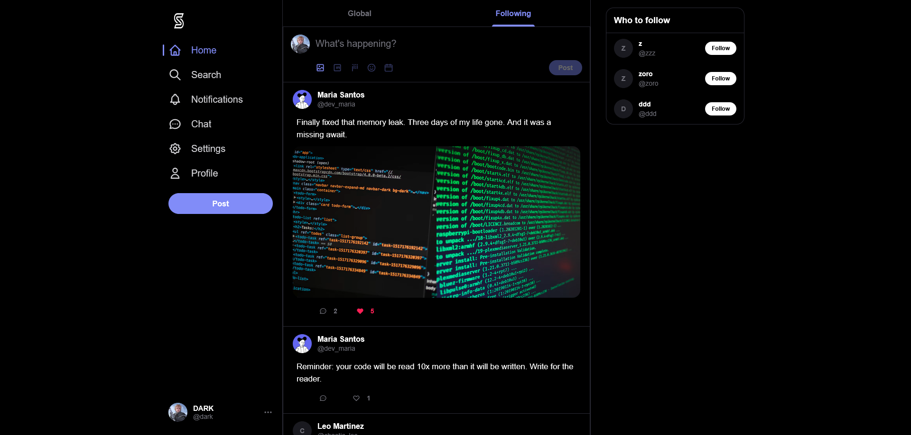
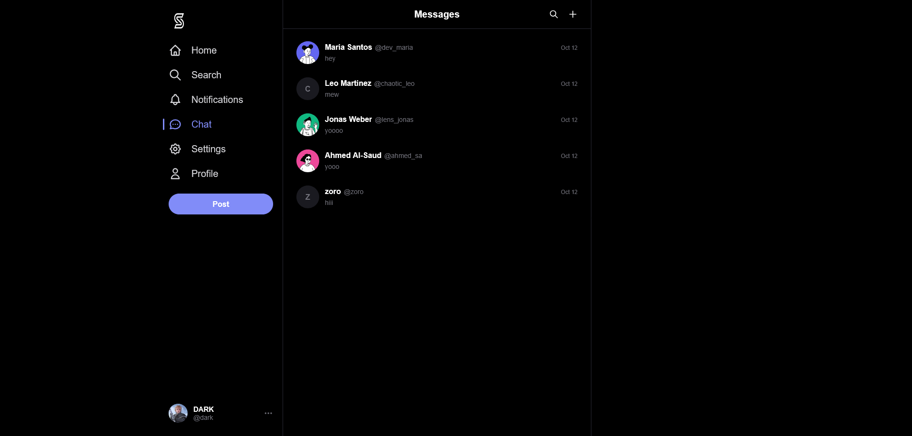
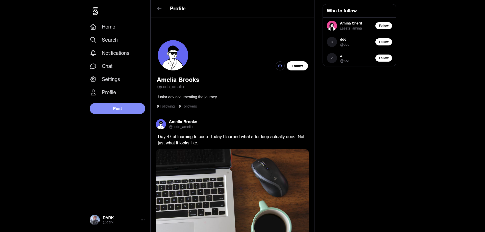
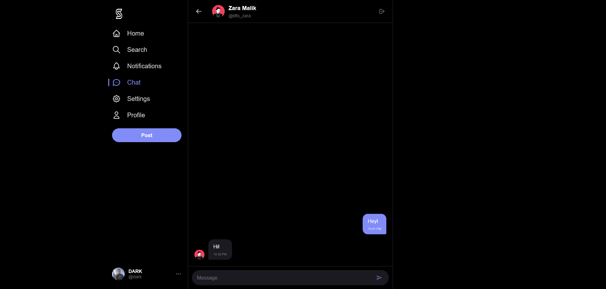

# S

**Live Demo:** [project-s-nine-kappa.vercel.app](https://project-s-nine-kappa.vercel.app)

> ⚠️ *The app requires an account to view. No email verification is needed—feel free to use a dummy email.*

A social platform for desktop, inspired by X — built as a learning project to explore full-stack development with Next.js and Supabase.

## Screenshots

| Feed | Messages | Profile |
| :---: | :---: | :---: |
|  |  |  |

 

  

 

## Why

I wanted to learn how a modern social app actually works — auth, realtime feeds, threaded replies, private messaging, image uploads, and the design of a social app. Instead of following tutorials, I built one from scratch over two weeks, iterating on UI, debugging realtime state, and shipping to production.

The goal was never to replace X. It was to understand every layer that sits between "a user clicks Post" and "the tweet appears on someone else's feed."

## Stack

- **Framework:** Next.js 16 (App Router, React 19)
- **Database + Auth + Storage:** Supabase (PostgreSQL, RLS policies)
- **Data fetching + caching:** TanStack React Query
- **Styling:** Tailwind CSS v4
- **Animation:** Motion (Framer Motion)
- **Deployment:** Vercel